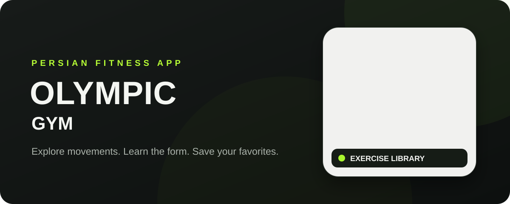

# Olympic Gym



**Olympic Gym** is a Persian-first fitness app for exploring exercise movements, learning how to perform them, and keeping a personal list of favorites. Exercise information and the user profile are stored locally on the device.

> The preview above combines the app's actual icon and exercise artwork. It is a project illustration, not a screenshot of the running app.

## Features

- Browse a library of more than 1,300 exercises.
- Search exercises and filter by category and equipment.
- Read Persian exercise instructions and view exercise images and GIFs.
- See Persian labels while keeping the dataset's English enum values in storage.
- Create a local profile and save or remove favorite exercises.
- Keep exercise data, profile information, and favorites in SQLite on the device.
- Use the exercise library and bundled media offline.

## App screenshots

Screenshots from the app show the home dashboard, searchable exercise library, and exercise details.

| Home | Exercise library | Exercise details |
| --- | --- | --- |
|  |  |  |

## Sample movement


## Tech stack

- React Native and Expo SDK 54
- Expo Router
- TypeScript
- Expo SQLite
- `expo-image`
- npm workspaces

## Repository structure

```text
apps/mobile/          Expo mobile application
  src/app/            Expo Router screens
  src/database/       SQLite schema, repositories, and seed logic
  assets/data/        Bundled exercise dataset
  assets/images/      Exercise images
  assets/videos/      Exercise demonstrations
packages/shared/      Shared exercise and enum contracts
packages/utils/       Dataset translation utilities
data/                 Source datasets and schemas
docs/                 Repository documentation images
```

## Requirements

- Node.js compatible with the installed Expo SDK
- npm
- Android Studio or an Android device for Android development
- Xcode and macOS for local iOS builds

## Getting started

From the repository root:

```bash
npm install
npm run start --workspace @gym-app/mobile
```

Then use the Expo terminal menu to open the app on an emulator or a connected device. To start a specific target:

```bash
npm run android --workspace @gym-app/mobile
npm run ios --workspace @gym-app/mobile
npm run web --workspace @gym-app/mobile
```

## Build Android releases

Run EAS commands from `apps/mobile`:

```bash
cd apps/mobile
npx eas-cli build --platform android --profile production
```

The `production` profile creates an Android App Bundle (AAB). For an APK build intended for direct distribution, use:

```bash
npx eas-cli build --platform android --profile bazaar-myket
```

The Android application ID is `com.abolfazl.olympicgym`. Keep the signing keystore and its passwords private and backed up securely; future updates to a store listing must use the matching signing key.

## Data and privacy notes

- The exercise dataset is bundled with the app and seeded into SQLite on the device.
- Profiles are local app profiles; they are not cloud accounts and do not provide server authentication or cross-device synchronization.
- Exercise image and GIF assets are bundled with the mobile app.

## Development

The phased roadmap and implementation history are documented in [DEVELOPMENT.md](DEVELOPMENT.md). Shared exercise types and dataset enum values live in [`packages/shared/src/index.ts`](packages/shared/src/index.ts).

Run the repository TypeScript checks with:

```bash
npm run typecheck
```

## License

No project license has been specified yet. Contact the repository owner before redistributing or reusing the source code or bundled assets.
